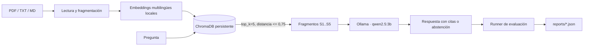

# RAG Evaluado

Asistente local de preguntas sobre documentos (RAG: Retrieval-Augmented Generation) que **cita sus fuentes y se abstiene cuando no tiene evidencia**, con un arnés de evaluación reproducible que mide cuándo acierta, cuándo se abstiene y cuándo se equivoca. Todo corre en local: ningún documento sale de la máquina.

> Principio de diseño: medir la calidad antes de presentar una respuesta como fiable.

## 1. Qué problema resuelve

Un LLM responde con aplomo aunque no sepa. En un sistema de consulta documental eso es peor que no responder. Este proyecto:

1. Recupera solo fragmentos relevantes de los documentos del usuario.
2. Obliga al modelo a responder únicamente con ese contexto y a citar los fragmentos usados.
3. Se abstiene ("No lo sé con los documentos disponibles") si no hay evidencia o no hay citas válidas.
4. Mide todo ello sobre un conjunto fijo de preguntas, para que cada cambio se compare con datos y no con impresiones.

## 2. Arquitectura



| Servicio | Tecnología | Puerto (solo localhost) |
| --- | --- | ---: |
| `dashboard` | Nginx sirviendo HTML estático (dashboard y chat) | 8001 |
| `api` | FastAPI + Uvicorn (ingesta, preguntas, evaluación) | 8000 |
| `ollama` | Generación con `qwen2.5:3b` | 11434 |

Decisiones técnicas y su motivo:

- **Embeddings `paraphrase-multilingual-MiniLM-L12-v2`**: funciona en español, es pequeño y corre en CPU.
- **ChromaDB persistente**: sin servidor adicional; el índice vive en `data/chroma`.
- **Fragmentos de 900 caracteres con solape de 150**: equilibrio entre contexto suficiente y precisión de recuperación; el solape evita cortar una respuesta por la mitad.
- **Umbral de distancia como filtro**: un fragmento lejano no llega al modelo. Es la palanca principal entre "responder de más" y "abstenerse de más".
- **Abstención en dos capas**: sin fragmentos recuperados, o con respuesta sin cita válida, se devuelve la abstención sin fiarse del texto del modelo.
- **`temperature=0` y salida JSON**: respuestas deterministas y fáciles de validar.

## 3. Estructura del repositorio

```text
app/api/          rutas FastAPI (/api/documents, /api/ask, /api/status, /api/evaluation/*)
app/ingestion/    lectura de PDF/TXT/MD y fragmentación
app/retrieval/    embeddings, búsqueda (store.py) y generación con citas (answer.py)
app/evaluation/   métricas y runner reproducible
app/static/       dashboard y chat web
evals/            corpus sintético (Orbe) y 35 preguntas de referencia
tests/            pruebas unitarias offline
reports/          resultados medidos en JSON
data/             documentos e índice locales (no se versionan)
```

## 4. Cómo ejecutarlo

Requisitos: Docker Desktop con Compose y conexión a Internet en la primera descarga (imágenes y modelos). El modelo `qwen2.5:3b` necesita memoria suficiente para Ollama.

```powershell
docker compose up -d --build
docker compose exec ollama ollama pull qwen2.5:3b
```

- Dashboard: <http://localhost:8001/>
- Chat: <http://localhost:8001/chat.html>
- Documentación interactiva de la API: <http://localhost:8000/docs>

Subir un documento y preguntar por API:

```powershell
curl.exe -X POST http://localhost:8000/api/documents -F "file=@evals/manual_demo.md"
curl.exe -X POST http://localhost:8000/api/ask -H "Content-Type: application/json" -d "{\"question\":\"¿Cuánto dura la prueba gratuita?\"}"
```

Parar sin perder índice ni modelo: `docker compose down`.

## 5. Evaluación

35 casos sobre un corpus sintético (Orbe, un servicio ficticio): 29 respondibles y 6 cuya respuesta no está en la fuente. Un caso respondible es correcto si el F1 por tokens frente a la respuesta de referencia es >= 0,45; uno no respondible, si el sistema se abstiene.

```powershell
docker compose exec -T api python -m app.evaluation.runner --no-judge
```

Tres mediciones sobre los mismos casos y el mismo corpus (solo Orbe), cambiando una cosa cada vez:

| Métrica | Umbral 0,45 | Umbral 0,75 | + corrección de citas |
| --- | ---: | ---: | ---: |
| Acierto total | 22,86 % | 34,29 % | **45,71 %** |
| F1 medio (respondibles) | 5,27 % | 21,29 % | **36,04 %** |
| Evidencia de referencia en citas | 6,90 % | 44,83 % | **68,97 %** |
| Falsas abstenciones (29) | 93,10 % | 55,17 % | **24,14 %** |
| Abstención correcta (6) | 100 % | 100 % | **100 %** |
| Respuestas sin apoyo en no respondibles | 0 % | 0 % | **0 %** |

Lectura honesta de los resultados:

- Relajar el umbral de 0,45 a 0,75 recuperó más evidencia.
- La tercera mejora vino de un **bug, no de un ajuste**: el modelo pequeño a veces devolvía la clave `citaciones` en lugar de `citations` y el código lo trataba como abstención. Ahora se aceptan esa variante y las citas `[S1]` escritas en el texto. Se verificó que no se perdieron abstenciones correctas (6/6) ni aumentaron las respuestas sin apoyo (0/6).
- Aún se rechaza el 24 % de las preguntas respondibles (7 de 29) y el acierto global es del 46 % (16 de 35): **es una mejora parcial, no calidad de producción**.
- El juez de fidelidad no se ejecutó; no hay puntuación independiente de fidelidad, porque el mismo modelo local que responde no sirve como árbitro.
- El corpus es sintético y pequeño; los porcentajes tienen un margen de error amplio.

## 6. Pruebas

Ocho pruebas unitarias offline (fragmentación, normalización, F1 por tokens, métricas de abstención) con el almacén y el modelo simulados:

```powershell
docker compose run --rm --no-deps --volume "${PWD}\tests:/workspace/tests:ro" api python -m unittest discover -s /workspace/tests -v
```

Además se comprobaron manualmente: endpoints, subida de documentos, rechazo de formatos no admitidos (415), entradas vacías o inválidas (422), abstención ante preguntas sin evidencia y CORS del chat. La cobertura de integración automatizada con modelos reales está pendiente.

## 7. Seguridad y privacidad

- Todo se ejecuta en local; no hay claves ni servicios externos.
- Los puertos se publican solo en `127.0.0.1`, de modo que Ollama (sin autenticación) y la API no son accesibles desde la red.
- La subida valida extensión (PDF, TXT, MD), rechaza archivos vacíos y limita a 20 MB; el nombre se reduce a su componente final para evitar recorridos de ruta.
- CORS restringido a los orígenes del dashboard.
- `data/` (documentos del usuario e índice), `.env*`, claves y salidas locales están en `.gitignore`.
- Limitaciones conocidas: la API no tiene autenticación (es de uso local), el contenedor corre como root y el límite de tamaño se comprueba tras leer el archivo. No exponer la API a Internet sin añadir autenticación y límites.

## 8. Cómo reproducir el proyecto desde cero

1. Crear la ingesta: leer PDF/TXT/MD y trocear en fragmentos con solape (`app/ingestion`).
2. Calcular embeddings y guardarlos en ChromaDB con la fuente y la página como metadatos (`app/retrieval/store.py`).
3. Buscar los `top_k` fragmentos más cercanos y descartar los que superen la distancia máxima.
4. Pedir al modelo una respuesta JSON usando solo el contexto numerado, y validar que las citas existan; si no, abstenerse (`app/retrieval/answer.py`).
5. Exponer todo con FastAPI y empaquetar con Docker Compose.
6. Construir un conjunto de preguntas con respuesta de referencia y casos sin respuesta, y un runner que calcule acierto, F1, cobertura de evidencia y tasas de abstención.
7. Iterar cambiando una variable por pasada y guardando cada informe en `reports/`.

## 9. Pendiente

1. Reducir las falsas abstenciones restantes sin aumentar respuestas sin apoyo (probar `top_k`, prompt y tamaño de fragmento, de uno en uno).
2. Añadir una fuente técnica pública con licencia clara y preguntas verificadas por una persona.
3. Pruebas de integración de ingesta, recuperación y generación, y GitHub Actions.
4. Autenticación y límites si se llega a exponer fuera de localhost.
5. Capturas del dashboard y del chat, y decidir licencia.

## 10. Autoría y asistencia

Proyecto de portfolio dirigido por Ismael: él define el objetivo, las prioridades y acepta los resultados. La implementación y revisión se hicieron con asistencia de IA (Codex, Claude Code y agentes auxiliares). Las mediciones proceden de ejecuciones guardadas en `reports/`; el corpus de demostración es sintético y no contiene datos reales.
